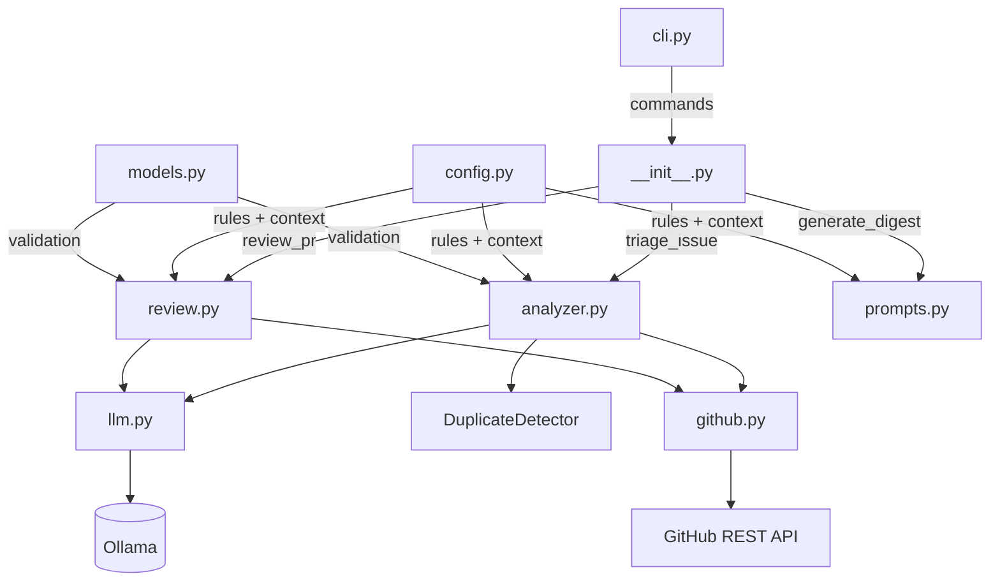

<!-- header:start -->
<div align="center">



<a href="#-quick-start"></a>

<a href="LICENSE"></a>

<a href="https://github.com/ajendras/mantis/stargazers"></a>
<a href="https://github.com/ajendras/mantis/actions/workflows/ci.yml"></a>

<a href="CONTRIBUTING.md"></a>

**Automates GitHub issue triage, PR reviews and maintainer tasks with local LLMs**

[✨ Features](#-features) • [⚡ Quick start](#-quick-start) • [🧰 Usage](#-usage) • [🧩 Architecture](#-architecture) • [📍 Roadmap](#-roadmap) • [🤝 Contributing](#-contributing)

</div>
<!-- header:end -->

## ✨ Why Mantis?

Open-source maintainers drown in issues, PRs and repetitive questions while burning out. Existing AI tools leak private repo data to the cloud and lack project-specific context. Mantis runs 100% locally, learns your conventions from the repo itself, and handles the busywork so humans can focus on architecture and community.

- Runs entirely with Ollama or any local OpenAI-compatible endpoint — nothing leaves your machine
- Learns tone, labels and priorities from your own issue and PR history
- Enforces every custom rule you define (style, security, process)
- Produces structured, copy-paste-ready output for GitHub while gracefully falling back when offline

## 🎬 Demo

<p align="center"></p>

## 🚀 Features

<table>
<tr>
<td>
🏷️ <b>Smart Triage</b><br>
Analyzes new issues and suggests accurate labels, priority, assignee and duplicates using project history
</td>
<td>
🔎 <b>Duplicate Detector</b><br>
Finds semantically similar past issues via targeted LLM prompts and conservative matching
</td>
<td>
📋 <b>PR Reviewer</b><br>
Generates contextual reviews with line-specific comments, verdicts and security flags
</td>
</tr>
<tr>
<td>
📅 <b>Weekly Digest</b><br>
Produces concise markdown reports of activity, decisions and suggested next steps
</td>
<td>
⚙️ <b>Rule Engine</b><br>
Injects and strictly respects custom project rules on every LLM call
</td>
<td>
💻 <b>Local-first</b><br>
Works offline with Ollama, LM Studio or any compatible endpoint; zero cloud leakage
</td>
</tr>
</table>

## 📦 Installation

Requires Python 3.9+ and a running Ollama instance with a model pulled (e.g. `ollama pull llama3`).

```bash
pip install mantis
mantis init
```

The `mantis` console script is automatically installed via the pyproject.toml entrypoint.

## ⚡ Quick start

```bash
mantis triage --repo ajendras/mantis --issue 42
```

Or via the Python API:

```python
from mantis import triage_issue, Config
from mantis.models import Issue

config = Config.load()
issue = {"title": "Segmentation fault on login", "body": "Crashes with SIGSEGV...", "number": 42}
result = triage_issue(issue, config=config)
print(result.labels, result.priority, result.duplicate_ids)
```

## 🧰 Usage

Run a full triage with model override:

```bash
mantis triage --repo ajendras/mantis --issue 123 --model llama3.1
```

Review a PR (fetches diff automatically):

```bash
mantis review --repo ajendras/mantis --pr 57
```

Generate a digest for the last 14 days:

```bash
mantis digest --repo ajendras/mantis --days 14
```

Initialize a new project with starter rules:

```bash
mantis init --rules "Never close issues without reproduction steps,Always label security issues as 'security'"
```

<details><summary>Library usage – full triage pipeline with mock data</summary>

```python
from mantis import triage_issue, Config
from mantis.models import Issue

config = Config(model="llama3", rules=["Use conventional commit labels"])
issue_dict = {
    "title": "Crash on startup with Python 3.12",
    "body": "Traceback shows... ",
    "number": 42,
    "html_url": "https://github.com/ajendras/mantis/issues/42"
}

result = triage_issue(issue_dict, config)
print(result.model_dump_json(indent=2))
```
</details>

<details><summary>Advanced: custom configuration and rule validation</summary>

```python
from pathlib import Path
from mantis import Config, generate_digest

config = Config.load(Path(".mantis/config.json"))
config.rules.append("All new features must include a test plan")
config.save()

report = generate_digest("ajendras/mantis", days=7, config=config)
print(report)
```
</details>

## 🔧 Configuration

| Option            | Default                  | Description |
|-------------------|--------------------------|-------------|
| model             | llama3                   | Ollama model name (or any OpenAI-compatible local endpoint) |
| temperature       | 0.3                      | Sampling temperature for the LLM (0.0–1.0) |
| github_token      | None                     | GitHub PAT for private repos or higher rate limits |
| ollama_base_url   | http://localhost:11434   | Base URL of the Ollama (or compatible) server |
| max_tokens        | 4096                     | Maximum tokens to request from the model |
| rules             | []                       | List of project-specific rules the LLM must follow on every run |

All options can be set via `MANTIS_*` environment variables, `.env`, or `.mantis/config.json`.

## 🧩 Architecture



Mantis composes small, single-responsibility modules that the public API and CLI orchestrate. Every LLM call receives the same system context and project rules from `Config.get_system_context()`. `analyzer.py` and `review.py` handle domain logic while `llm.py` abstracts model access and JSON parsing with graceful offline fallbacks.

## 📁 Project structure

```text
src/mantis/
├── __init__.py          # Public API: triage_issue(), review_pr(), generate_digest(), Config
├── cli.py               # Typer CLI with commands: init, triage, review, digest, config
├── config.py            # Pydantic Settings, rule validation, system context
├── llm.py               # LLM wrapper with JSON mode, streaming and error handling
├── github.py            # GitHubClient with get_issue(), get_pr_diff(), list_recent_issues()
├── analyzer.py          # IssueAnalyzer + DuplicateDetector using TRIAGE_PROMPT
├── review.py            # PRReviewer using REVIEW_PROMPT and structured Review output
├── prompts.py           # Template constants and format_* functions
├── models.py            # Pydantic models: Issue, PR, TriageResult, Review, Comment
└── ...

tests/
├── conftest.py          # Fixtures: mock_llm, mock_github_client, sample_issue
├── test_analyzer.py     # Tests analyze(), duplicate detection, fallback triage
├── test_review.py       # Tests PRReviewer.review(), verdict logic and rule adherence
└── ...

examples/
└── triage_example.py    # Runnable example using mock issue and full pipeline
```

## 🧪 Testing

```bash
pytest -q
```

Tests cover `IssueAnalyzer.analyze()`, `DuplicateDetector.find_duplicates()`, `PRReviewer.review()`, rule injection, fallback behavior, model validation and CLI output paths using the `mock_llm` and `mock_github_client` fixtures.

## 📍 Roadmap

<!-- roadmap:start -->
- [x] **v0.1.0** — first release: Smart Triage, Duplicate Detector, PR Reviewer, Reply Assistant
- [ ] Add GitLab support alongside GitHub
- [ ] Interactive approval mode before posting comments
- [ ] Persist learned project conventions in a local vector store
- [ ] Support for additional local backends (llama.cpp, MLX)
- [ ] Few-shot examples pulled from repo's past maintainer comments
- [ ] Discord and Slack notification hooks for high-priority items
- [ ] Auto-generate release notes from merged PRs and linked issues
- [ ] Plugin system for custom Python hooks that run after LLM decisions
- [ ] Web UI dashboard showing pending triage queue and decision log
- [ ] Command to fine-tune a small model on a repo's historical decisions
- [ ] Integration with conventional commits for automatic changelog entries
- [ ] Scheduled weekly digest email option (local SMTP or sendgrid-free)

> 🤖 This roadmap is worked through continuously — ideas and PRs welcome!
<!-- roadmap:end -->

## 🤝 Contributing

Contributions are welcome and appreciated! Please read [CONTRIBUTING.md](https://github.com/ajendras/mantis/blob/main/CONTRIBUTING.md) and adhere to our [Code of Conduct](https://github.com/ajendras/mantis/blob/main/CODE_OF_CONDUCT.md). Good-first-issue PRs are tagged and make excellent places to start.

## 📄 License

MIT © Mantis Contributors — see [LICENSE](LICENSE).

<!-- footer:start -->
<div align="center">

### ⭐ Star history

<a href="https://star-history.com/#ajendras/mantis&Date"></a>

If **Mantis** saves you time, a ⭐ helps others find it.

Made with ❤️ by [Ajendra](https://ajendra.info)


</div>
<!-- footer:end -->
